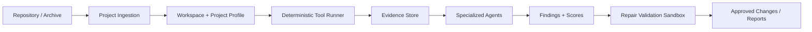

# Project Aegis Final Report Draft

## Abstract

Project Aegis is an evidence-grounded software quality platform designed to help development teams analyze repositories, interpret tool output, and validate repair suggestions under controlled conditions. The system combines deterministic analysis tools, typed multi-agent contracts, durable analysis jobs, isolated execution boundaries, and reviewable reporting. In the current implementation, repository ingestion, project profiling, deterministic tool execution, agent-based evidence interpretation, findings scoring, repair validation, and report generation are all implemented and verified through phase-gate checks.

The project is intentionally scoped to a controlled MVP: it does not attempt unrestricted autonomous code generation, and it avoids unsafe direct mutation of the user repository. Instead, it records evidence, routes findings through structured AI interpretation, and validates any suggested repair in a sandbox before marking it as accepted or rejected.

## 1. Introduction

Modern software quality workflows are often fragmented. Linting output, dependency advisories, security findings, test results, and API validation checks are produced by different tools, each with its own format and severity semantics. This fragmentation makes it difficult for developers to understand the true health of a project and to decide which findings deserve action.

Project Aegis addresses this issue by separating two concerns: deterministic evidence generation and AI-based interpretation. The system first runs verifiable quality tools in a bounded execution environment, normalizes the outputs into structured evidence records, and then passes these records to specialized agents. The agents do not operate on unstructured content or raw repository state directly; instead, they consume typed evidence and preserve provenance throughout the process.

The platform is designed around a research-oriented objective: to test whether evidence-grounded multi-agent reasoning can produce useful software quality findings and repair suggestions while maintaining traceability and bounded execution.

## 2. Problem Statement

Teams frequently encounter noisy, inconsistent, and hard-to-prioritize quality data. In many cases, the same repository can produce warnings from several toolchains, but the results are not unified, not source-linked, and not readily compared. This leads to slow review cycles, duplicated effort, and limited confidence in automated recommendations.

The project addresses this by creating a platform that:

- ingests repositories safely
- profiles the project structure and technology stack
- runs deterministic quality tools in isolated workspaces
- records tool evidence and execution metadata
- summarizes findings using typed specialized agents
- validates repair candidates in a sandbox before approval
- generates reviewable reports for human stakeholders

## 3. Requirements and Scope

The project scope for Version 1 is deliberately limited to the quality-assurance workflow rather than autonomous software generation. The key functional requirements are:

- import a repository or archive safely into a managed workspace
- analyze the repository structure and determine likely technology stack
- run deterministic tools such as type checking, linting, dependency audits, security scans, tests, API checks, browser/accessibility checks, and performance probes
- preserve evidence from each tool execution
- summarize findings with severity, source, confidence, and run metadata
- support repair proposal generation based on structured evidence
- validate proposed repairs in a sandbox before they are accepted
- produce findings and report artifacts that can be reviewed by a human operator

The system intentionally excludes unrestricted repository mutation, unrestricted remote execution, and unbounded deployment automation. These boundaries are enforced to make the project safer and more suitable for controlled evaluation.

## 4. System Architecture

The architecture follows a layered design.

### 4.1 API and persistence layer

The API layer provides project management, repository management, analysis jobs, findings, repair workflows, settings, and reports. PostgreSQL with Prisma is used as the durable persistence layer for projects, repositories, runs, analysis events, tool executions, findings, scores, and report metadata.

### 4.2 Workspace and execution layer

Repository content is processed in a managed workspace. Deterministic tools execute in a Dockerized sandbox with restricted networking, resource limits, file-system constraints, and bounded output capture. This prevents accidental access outside the project boundary and makes the system suitable for sensitive or untrusted code.

### 4.3 Agent layer

The system uses typed agent contracts and a registry of specialized agents. Each agent receives structured evidence and returns schema-valid findings or recommendations. The agent surface includes project analysis, code quality, security, dependency, test, API, UI/accessibility, performance, repair, and reporting roles.

### 4.4 Frontend layer

The React/Vite frontend provides project setup, repository ingestion, analysis progress monitoring, findings views, detailed evidence review, repair management, and reporting flows. It is designed to keep the user informed without exposing internal execution details.

## 5. Implementation Summary

The implementation covers the main MVP workflow:

- project creation and repository import
- path-safe processing and archive handling
- deterministic tool execution in isolated containers
- analysis job lifecycle management with progress tracking
- evidence persistence for tool runs and source-linked outputs
- agent contracts and output schemas
- findings and quality-score aggregation
- repair proposal and sandbox validation
- Markdown report generation and review summary delivery

A major implementation objective was to ensure that evidence is captured before AI interpretation. This prevents the agents from inventing unsupported findings and makes the produced output auditable.

## 6. Testing and Validation Strategy

The project uses phase-based validation with executable checks at each stage. These checks cover:

- agent registration and contract validation
- ingestion and workspace safety
- analysis job orchestration and deterministic tool execution
- adapter pipeline correctness
- agent output validity
- findings workflow and score processing
- repair validation lifecycle
- report generation and GitHub review-style delivery

The API and web builds both pass in the current workspace, and the final seeded evaluation command also passes.

## 7. Evaluation Results

A versioned benchmark fixture was created to measure the project’s detection and repair behavior under controlled conditions. The relevant metrics are recorded in the project evaluation artifacts and the final evaluation gate.

| Metric | Result |
|---|---:|
| True positives | 3 |
| False positives | 1 |
| False negatives | 1 |
| Precision | 0.75 |
| Recall | 0.75 |
| F1 | 0.75 |
| Repair acceptance rate | 0.6667 |
| Repair validation pass rate | 0.5 |
| Regression rate | 0.5 |

These results are intentionally presented as controlled evidence from a local benchmark rather than as broad production claims. They are useful for demonstrating the pipeline works and that the repair and findings flows are traceable, but they do not support a claim of universal superiority.

## 8. Discussion

The project demonstrates that an evidence-first architecture can provide a practical foundation for software quality analysis. The strongest feature of the system is not that it produces autonomous patches without oversight, but that it preserves human review and verification while still automating the heavy lifting of repository analysis and evidence synthesis.

The local benchmark also surfaced a key lesson: provider availability and output validation are essential. During the earlier evaluation run, the local Ollama provider was unavailable and the agent pipeline returned malformed structured output. Once service validation and JSON parsing checks were added, the dependency agent completed successfully. This reinforces the project’s design principle that AI components must fail safely and produce traceable errors rather than silently fabricate results.

## 9. Security and Risk Considerations

Security is a critical design concern because the system analyzes untrusted project content. The implementation uses:

- restricted execution containers
- limited network access
- workspace isolation
- bounded output capture
- repository path validation
- explicit approval gates for change execution
- deterministic evidence capture instead of free-form unsafe execution

These controls lower the risk of command injection, path traversal, workspace escape, and unreviewed mutation. The system therefore remains intentionally conservative in its repair execution model.

## 10. Limitations

The current evidence base is still limited in scope. The evaluation has been run on seeded local fixtures rather than a broad dataset of production repositories. This means the project demonstrates feasibility and a working pipeline, but not yet broad generalization. The benchmark is therefore best interpreted as a reproducible local proof-of-concept rather than a definitive production-performance claim.

Additional limitations include:

- limited number of benchmark repositories
- no large-scale comparative study against mature tools
- small sample of repair validations
- local-only environment rather than a broad cloud deployment trial

## 11. Future Work

The most important next steps are broadening the benchmark, validating on additional repositories, and improving repair coverage. The future roadmap includes:

- pinned benchmark repositories with documented ground truth
- higher-volume evaluation runs for precision, recall, and F1 stability
- more repair scenarios and regression checking
- stronger model routing and provider resilience
- deeper reporting and dashboard refinement
- final institutional formatting and submission preparation

## 12. Conclusion

Project Aegis demonstrates a working evidence-grounded software quality platform that combines deterministic quality tooling, multi-agent interpretation, execution safety, and validation-driven repair support. While the current evaluation remains bounded to a local benchmark, the project has reached a credible MVP stage with clear architecture, passing validation gates, and a reproducible analytical workflow.

The project provides a strong foundation for continued development and a realistic pathway toward broader evaluation, stronger academic validation, and eventual production deployment in a more mature stage.
